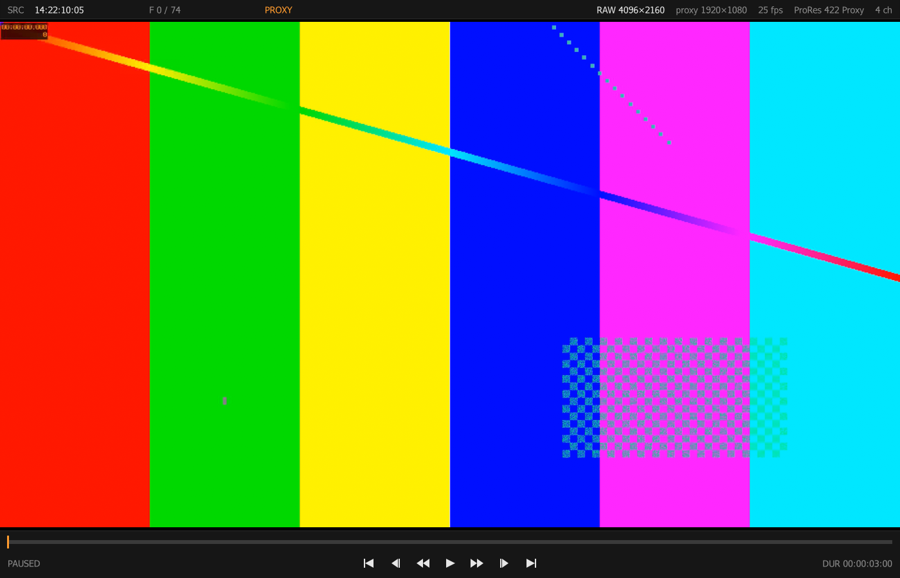

# Nils-Player

A fast, frame-accurate review player for Windows. One exe containing [mpv](https://mpv.io),
[MediaInfo](https://mediaarea.net/MediaInfo) and a review-oriented interface: JKL shuttle, arrow-key
frame stepping, source timecode, and a picture that nothing is ever drawn on.

## Download
Get `Nils-Player-vX.Y.exe` from [Releases](../../releases). Nothing to install. Windows SmartScreen may
warn the first time because the exe isn't signed ("More info" > "Run anyway").
Plays everything FFmpeg decodes, including ProRes (all variants) and HAP / HAP Alpha / HAP Q.

## Layout
- **Top bar:** source timecode (SRC, or REL counted from zero if the file has none) and
  frame number on the left; resolution, frame rate, codec and audio channels on the right.
- **Picture:** nothing is ever drawn on it. No OSC, no OSD messages.
- **Bottom bar:** scrub bar (click or drag; hover shows the timecode), buttons
  (start, step back, J, play/pause, L, step forward, end), shuttle state, duration.
- **M:** full MediaInfo report in a side panel. The picture shrinks instead of being covered.
- Both bars stay visible in fullscreen and are clickable.

## Canon Cinema RAW Light (.CRM)
mpv/FFmpeg can't decode .CRM, so the player plays the clip's proxy instead:
- Opening `A001C001_xxxx.CRM` plays the file with the same name (a suffix like `_proxy` is fine)
  from the `Proxy` folder next to it - the layout Blackmagic Proxy Generator writes.
- Top bar shows `PROXY`, the RAW resolution, then the proxy's own details dimmed.
  Timecode comes from the RAW when MediaInfo can read it; `TC differs from RAW` is shown if the
  proxy's timecode doesn't match.
- No proxy: the top bar says so and the picture stays black (the RAW is not opened).
- Opening a proxy directly from `Proxy\` is recognised the same way.
- Dropping a card or folder: subfolders are scanned, .CRM files are included and proxies whose
  RAW is in the same drop are removed, so each clip appears once.
- `M` shows MediaInfo for the proxy, then for the RAW original.

## Audio-only files
- Timecode is shown at 25 fps (`TC @ 25 fps`). Broadcast WAV files from field recorders show their
  start timecode (`SRC`); plain WAVs count from zero (`REL`).
- Top bar right: `AUDIO`, sample rate, bit depth / codec, channels.
- Left / Right step one 25 fps frame (40 ms).

## Use
- Double-click to open an empty player and drop files on it, drag a file onto the exe,
  or set it as default app ("Open with" > Choose another app) for .mov / .mxf / .mp4.
- First launch unpacks to `%LOCALAPPDATA%\Nils-Player\<build-id>\` (a few seconds).
  Later launches start straight from there. A new build replaces the old cache automatically.
- Uninstall: delete the exe and `%LOCALAPPDATA%\Nils-Player`.

## Keys
| Key | Action |
|---|---|
| L / J | Play forward / backward, press again for 2x / 4x / 8x |
| K, Space | Pause / play-pause |
| Left / Right | One frame (hold to repeat) |
| Mouse wheel over a bar | One frame |
| Shift+Left / Right | 1 second |
| Up / Down | 10 seconds |
| Home / End | First / last frame |
| T, click timecode | Switch SRC timecode / elapsed from start (REL) |
| M | MediaInfo panel (wheel / Up Down PgUp PgDn scroll, M or Esc closes) |
| i / I | mpv stats overlay (on demand, covers the picture) |
| f, double-click picture | Fullscreen |

## Changes
- v1.7: click the timecode (or press T) to switch between the file's own timecode (SRC) and
  elapsed time from the start (REL). The label turns orange while REL overrides a file's timecode.
- v1.6: clicking or dragging the playhead (and the start/end buttons) no longer stops playback;
  speed and direction are kept.
- v1.5: audio-only files (WAV, MP3 ...) show timecode at 25 fps (Broadcast WAV start TC is used),
  sample rate / bit depth / channels; arrow keys step one 25 fps frame.
- v1.4: renamed from mpv-review to Nils-Player (exe, window title, cache folder; old cache removed on first run).
- v1.3: own icon (also on the player window/taskbar); Canon .CRM opens its proxy from `Proxy\`;
  H.264/H.265 named as such.
- v1.2: picture kept clean; fixed info bar above and clickable transport bar below the
  picture; clip summary (resolution, fps, codec, audio); MediaInfo as a side panel.
- v1.1: single exe; source timecode via bundled MediaInfo.
- v1.0: config + scripts for a separate mpv install.

## How it's put together
| Folder | What |
|---|---|
| `config/` | mpv config (`mpv.conf`, `input.conf`) and the Lua scripts: `review-ui.lua` (bars, timecode, MediaInfo panel, CRM proxies) and `jkl.lua` (shuttle and stepping) |
| `helper/` | `mi-helper.exe` (Go): talks to `MediaInfo.dll` for timecode, codec names and the report |
| `launcher/` | `Nils-Player.exe` (Go): embeds everything, unpacks once to `%LOCALAPPDATA%\Nils-Player\`, starts mpv |
| `seticon/` | build tool that puts the icon into `mpv.exe` so the window and taskbar show it |
| `icon/` | icon sources (separate drawings for 16-24, 32-48 and 64-256 px) |

## Building (Linux)
Needs Go, zip, binutils-mingw-w64 (windres) and Wine (to stamp the icon into mpv.exe).

1. Download a Windows mpv build (x86_64) from [zhongfly/mpv-winbuild](https://github.com/zhongfly/mpv-winbuild/releases)
   and unpack it to `$DL/mpvx/`.
2. Put `MediaInfo.dll` and `License.html` in `$DL/mi/pymediainfo/` (for example from the
   `pymediainfo` win_amd64 wheel on PyPI, or the MediaInfo DLL download).
3. Run `DL=/path/to/downloads ./build.sh`. Output: `dist/Nils-Player.exe`.

## Licence
Nils-Player is licensed under the GNU General Public License v3.0 (see `LICENSE`).

The released exe bundles third-party software under their own licences:
- **mpv** (GPLv2 or later), Windows build by [zhongfly/mpv-winbuild](https://github.com/zhongfly/mpv-winbuild),
  including FFmpeg and other libraries. Source: [mpv-player/mpv](https://github.com/mpv-player/mpv); the exact
  build and its source revisions are named in each release's notes.
- **MediaInfo** (BSD-2-Clause), [MediaArea](https://mediaarea.net). Its licence text is included in the exe's
  unpacked `licenses` folder.
